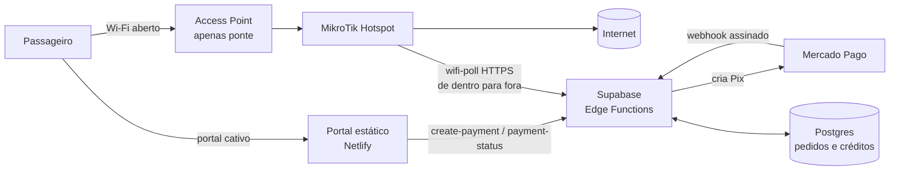

<div align="center">

# 📶 mikrotik-if

**Hotspot MikroTik com autenticação automática via Pix, controle de tempo e integração com Supabase, Netlify e Mercado Pago.**

[](https://github.com/crdso/mikrotik-if/actions/workflows/ci.yml)


</div>

> **EN:** Pay-by-Pix Wi-Fi hotspot for MikroTik: one product (default BRL 5.00 = 5 cumulative hours), automatic MAC-based release, Supabase backend, Mercado Pago Pix and a static Netlify portal. Docs are in Brazilian Portuguese.

---

## ⚠️ Estado do projeto — leia antes de usar

O código foi revisado em auditoria e **testado em simulação** (banco Postgres real em memória, Mercado Pago e MikroTik simulados, portal no navegador). O backend também foi publicado e verificado num projeto Supabase real, **sem pagamentos**.

**Ainda não foi validado em produção.** Falta, e depende de você: credenciais reais do Mercado Pago, um Pix real, o roteador físico e celulares reais. Os comandos de RouterOS **não foram executados em equipamento**. A lista completa do que não foi provado está em [docs/testes.md](docs/testes.md#o-que-os-testes-não-provam). **Não cobre usuários reais antes dos testes finais** do [guia de instalação](docs/instalacao.md).

## O que é

Um sistema genérico para vender acesso Wi-Fi por **Pix** em qualquer rede com **Hotspot MikroTik**. O passageiro conecta ao Wi-Fi aberto, paga **R$ 5,00** e recebe **5 horas de uso acumulado**, liberadas automaticamente pelo MAC do aparelho. Ao fim do tempo, o Hotspot corta e ele pode comprar de novo (o tempo restante nunca é perdido nem duplicado).

## ✨ Funcionalidades

- **Pix dinâmico** (QR Code e Copia e Cola) pela API oficial do Mercado Pago, com **chave de idempotência**.
- **Webhook com assinatura**, leitura do **status real** na API e **reconciliação** automática se a notificação não chegar.
- **Liberação somente após pagamento aprovado**: valor, moeda, meio e vínculo com o pedido são conferidos no banco.
- **Crédito acumulado:** compras adicionais somam ao tempo restante; um pagamento nunca credita duas vezes (idempotência por pedido, por ACK e por marcador no roteador).
- **Aviso de tempo esgotado:** quando as horas acabam, o portal mostra "Seu tempo de internet acabou" e oferece "Comprar mais 5 horas" (o roteador informa o esgotamento; o controle de tempo continua sendo só do MikroTik).
- **Sem usuário e senha:** o MikroTik consulta o backend (HTTPS **de dentro para fora**, funciona atrás de CGNAT, sem abrir portas).
- **RouterOS 6.43+ e 7** (protocolo de texto simples, sem JSON no roteador).
- **Independente do Access Point:** o AP só faz a ponte Wi-Fi; nenhuma lógica no AP.
- **Portal responsivo** (320 px), com contagem regressiva, recuperação do pedido e estados de erro; CSP restritiva.
- **Falha segura:** sem segredos, sem banco ou sem Mercado Pago, nada libera internet.

## 🧭 Como funciona



1. O Hotspot serve `login.html`, que leva o MAC do aparelho ao portal.
2. O portal pede o Pix; o servidor cria **um** pedido por aparelho e a cobrança de R$ 5,00.
3. O Mercado Pago avisa o pagamento por webhook assinado; o servidor **relê o pagamento na API** e o banco valida.
4. O `wifi-poll` do MikroTik lê os pedidos pagos, cria ou **soma** o tempo do usuário (nome = MAC) e confirma (ACK).
5. O Hotspot corta no `limit-uptime`.

Detalhes e estados do pedido em [docs/arquitetura.md](docs/arquitetura.md).

## 🧰 Tecnologias

| Camada | Tecnologia |
|---|---|
| Roteador | MikroTik RouterOS 6.43+ / 7 (Hotspot, scripts `.rsc`) |
| Portal | HTML, CSS e JavaScript puros (sem dependências), hospedado na Netlify |
| Backend | Supabase: Postgres (RLS, funções SQL) e Edge Functions (TypeScript/Deno) |
| Pagamentos | Mercado Pago — API de Pagamentos (Pix) |
| Testes | Node 24 (`node:test`), PGlite (Postgres em WebAssembly) |

## 🔌 Compatibilidade e limitações (RouterOS)

| Recurso | RouterOS 6.43+ | RouterOS 7 |
|---|---|---|
| Script `hotspot-poll.rsc` | ✅ alvo de desenvolvimento (6.48.x) | ✅ |
| `:serialize`, `:deserialize`, `:onerror` | ❌ não existem (por isso o protocolo é texto) | ✅ (não usados) |
| HTTPS com validação de certificado | ⚠️ **depende de teste real**: exige importar a CA e o TLS do `fetch` precisa negociar com o servidor | ✅ |

- Nenhum comando RouterOS foi executado em equipamento. O script `router/diagnostico.rsc` (**somente leitura**) mostra no seu roteador o que funciona antes de instalar qualquer coisa.
- O RouterOS 6 não traz CA instalada: é preciso importar a raiz do servidor ([docs/mikrotik.md](docs/mikrotik.md#4-certificado-da-ca-o-routeros-6-não-traz-nenhuma)). Se o TLS não funcionar, há alternativas documentadas.
- Estorno depois da liberação **não revoga** o acesso já concedido; MAC pode ser falsificado ou aleatório (não é autenticação forte).

## 🖥️ Requisitos

| Item | Requisito |
|---|---|
| Roteador | MikroTik com **Hotspot** funcionando e RouterOS 6.43+ (referência de desenvolvimento: hEX lite, RouterOS 6.48.6, 64 MB de RAM, 16 MB de flash, 1 núcleo de 850 MHz) |
| Access Point | Qualquer um, em **modo ponte** (DHCP e NAT desligados), ou Wi-Fi integrado do MikroTik |
| Internet | Qualquer origem com saída HTTPS (CGNAT é aceito) |
| Contas | Supabase, Mercado Pago (Pix habilitado), Netlify, GitHub |
| Computador | Node ≥ 22.6 (testes: Node 24) e a [Supabase CLI](https://supabase.com/docs/guides/cli) |

> **Hardware antigo:** com ~40 aparelhos, TLS e filas de limite de banda pesam num hEX lite. **Nenhum desempenho é garantido sem teste real.**

## 📁 Estrutura

```text
site/        Portal estático (index.html, app.js, style.css, config.js, _headers)
supabase/    config.toml, migrations/ (SQL) e functions/ (4 Edge Functions + _shared)
router/      login.html, hotspot-poll.rsc (RouterOS 6+), diagnostico.rsc (somente leitura)
scripts/     prepare-site.mjs (build do portal), smoke.mjs (verificação sem cobrança)
tests/       Testes automatizados          dev/   Servidor local de demonstração
docs/        Documentação completa         netlify.toml   Build da Netlify
```

## 🚀 Instalação rápida

```sh
git clone https://github.com/crdso/mikrotik-if.git && cd mikrotik-if
npm install
npm test          # suíte completa (simulada)
npm run dev       # portal + backend simulados em http://localhost:8787/?mac=AA:BB:CC:DD:EE:10
```

A ordem completa de implantação é: **Supabase → Mercado Pago → Netlify → teste de Pix real → MikroTik → celulares** ([docs/instalacao.md](docs/instalacao.md)).

## 🗄️ Configuração do Supabase

1. Crie um projeto **dedicado** e anote o **Reference ID** (Settings → General).
2. Aplique `supabase/migrations/202611170001_hotspot_orders.sql` (SQL Editor ou `supabase db push`).
3. Publique as funções (a CLI usa `supabase/config.toml`, que desliga a verificação de JWT — cada função autentica por conta própria):

```sh
for f in create-payment payment-status mp-webhook router-sync; do
  supabase functions deploy $f --project-ref SEU_REFERENCE_ID --no-verify-jwt --use-api
done
```

4. Cadastre os **segredos** em *Edge Functions → Secrets* no painel (ou `supabase secrets set`). **Nunca** os coloque no repositório.

Detalhes, consultas de suporte e rotação de chave: [docs/supabase.md](docs/supabase.md).

### Variáveis de ambiente (Secrets das Edge Functions)

Modelo em [`.env.example`](.env.example) (apenas nomes e placeholders):

```ini
MP_ACCESS_TOKEN=SEU_TOKEN_PRODUTIVO        # Mercado Pago > Credenciais de produção
MP_WEBHOOK_SECRET=SEGREDO_WEBHOOK          # Mercado Pago > Webhooks > chave secreta
ROUTER_SHARED_KEY=GERE_32_OU_MAIS_BYTES    # gerada por você; a mesma vai no script do roteador
SITE_ORIGIN=https://seu-portal.exemplo     # URL final do portal, sem "/" no fim
```

Enquanto algum segredo estiver ausente, as funções **recusam** (403/401/500/502) e **nunca liberam** internet ([testado](tests/secrets-missing.test.mjs)).

## 💳 Configuração do Mercado Pago

1. *Developers → Suas integrações*: crie uma aplicação (API de Pagamentos); a conta precisa ter **Pix habilitado**.
2. Copie o **Access Token de produção** → segredo `MP_ACCESS_TOKEN`.
3. *Webhooks* (produção): URL `https://SEU_REFERENCE_ID.supabase.co/functions/v1/mp-webhook`, evento **Pagamentos** → copie a chave secreta → `MP_WEBHOOK_SECRET`.
4. "Simular notificação" deve responder **sem `401`**. Faça um **Pix real de R$ 5,00 você mesmo** antes de ligar o roteador.

Tudo sobre o fluxo, estados e o que não foi verificado: [docs/mercado-pago.md](docs/mercado-pago.md).

## 🌐 Deploy pela Netlify (sem copiar arquivos)

1. **Netlify → Add new project → Import an existing project → GitHub →** selecione o repositório (`crdso/mikrotik-if` ou o seu fork).
2. Não preencha nada de build: o [`netlify.toml`](netlify.toml) já define o comando (`node scripts/prepare-site.mjs`) e a pasta publicada (`dist-site`).
3. **Antes do primeiro deploy**, em *Site configuration → Environment variables*, crie a variável **pública** de build:

   | Variável | Valor |
   |---|---|
   | `SUPABASE_PROJECT_REF` | Reference ID do projeto Supabase (ex.: `abcdefghijklmnopqrst`) |

   (alternativa: `SUPABASE_URL=https://<Reference ID>.supabase.co`). Sem ela o build **falha** com uma mensagem clara.
4. Faça o deploy. **Etapa posterior (depende da URL final):** copie a URL do site e cadastre-a no Supabase como `SITE_ORIGIN` (sem `/` no fim); depois rode `scripts/smoke.mjs`.
5. **Nunca** cadastre na Netlify `MP_ACCESS_TOKEN`, `MP_WEBHOOK_SECRET`, `ROUTER_SHARED_KEY` nem a chave `service_role`: o portal não usa nenhuma.

Detalhes e limitações do portal cativo: [docs/netlify.md](docs/netlify.md).

## 📡 Configuração do MikroTik

O guia [docs/mikrotik.md](docs/mikrotik.md) é feito para um Hotspot **que já funciona**: tudo é acréscimo reversível e cada passo tem o comando para desfazer. Resumo (os arquivos finais, **com os valores da sua instalação**, saem de `npm run prepare-router` em `router-dist/`, pasta ignorada pelo Git — veja a [seção 11 do guia](docs/mikrotik.md#11-gerar-os-arquivos-com-os-valores-da-sua-instalação)):

1. Backup (`/export` e `/system backup save`), guardado **fora** do repositório.
2. `router/diagnostico.rsc` (somente leitura): versão, memória, relógio, recursos da linguagem e HTTPS.
3. Importar a CA do servidor (com conferência da impressão digital).
4. Perfil `wifi-5h` (`rate-limit=1M/4M`) e `mac` acrescentado ao `login-by` do Hotspot.
5. Walled Garden **só** para o portal e o projeto Supabase.
6. `router/login.html` e o script `wifi-poll` (rodar à mão primeiro; depois agendar).

Segurança do painel, isolamento dos passageiros, reinicialização e procedimento de emergência: [docs/operacao-e-seguranca.md](docs/operacao-e-seguranca.md).

## 🎨 Personalização do nome e do visual

O portal exibe o nome do serviço no cabeçalho e nas mensagens. Para usar outro nome, troque `3TRC_Starlink` em `site/index.html`, `site/app.js`, `router/login.html` e na constante `SERVICE_NAME` de `supabase/functions/_shared/common.ts` (usada na mensagem de erro e na descrição da cobrança Pix). O visual é CSS puro (`site/style.css`) com um SVG leve (`site/art.svg`): sem fontes nem bibliotecas externas, compatível com a CSP e com navegadores de portal cativo.

## 🧪 Testes

```sh
npm test                 # suíte completa (simulada); roda também no CI
npm run test:mutation    # planta falhas de propósito e confere se os testes as detectam
npm run dev              # demonstração local, sem credenciais
node scripts/smoke.mjs   # verificação SEM cobrança contra um Supabase publicado (veja o cabeçalho do arquivo)
```

Os testes são **simulados** (Mercado Pago e MikroTik) e o banco é real em memória; o que **só** equipamento ou contas reais provam está listado em [docs/testes.md](docs/testes.md).

## 📚 Documentação completa

| Documento | Conteúdo |
|---|---|
| [docs/instalacao.md](docs/instalacao.md) | **Ordem de implantação** e testes finais |
| [docs/arquitetura.md](docs/arquitetura.md) | Componentes, fluxo, estados, camadas de segurança |
| [docs/mikrotik.md](docs/mikrotik.md) | RouterOS 6.48/7: diagnóstico, CA, Hotspot, Walled Garden, script, reversão |
| [docs/operacao-e-seguranca.md](docs/operacao-e-seguranca.md) | Painel, isolamento, backup, logs, reinicialização, emergência, capacidade |
| [docs/supabase.md](docs/supabase.md) | Banco, funções, segredos, rotação de chave |
| [docs/mercado-pago.md](docs/mercado-pago.md) | Pix, webhook, estados do pagamento |
| [docs/netlify.md](docs/netlify.md) | Portal, importação do GitHub e portal cativo |
| [docs/testes.md](docs/testes.md) | Como testar e o que cada teste prova |
| [docs/auditoria.md](docs/auditoria.md) | Problemas encontrados e correções |

## 🔒 Avisos de segurança

- **Nunca versione** tokens, chaves, `.env` com valores reais, backups ou exports do MikroTik (o `.gitignore` bloqueia os padrões comuns).
- Segredos só nos **Secrets do Supabase** e no script do roteador; o portal não tem nenhuma chave.
- O MAC é identificador de aparelho, **não** credencial forte. Estorno depois da liberação exige ajuste manual.
- Antes de cobrar usuários reais: faça o Pix real, o teste de corte por tempo, a compra dupla, a reinicialização e a queda da internet, em iPhone **e** Android.

## 📄 Licença

Ainda não definida pelo mantenedor. Até que uma licença seja adicionada, aplicam-se os direitos autorais padrão.
